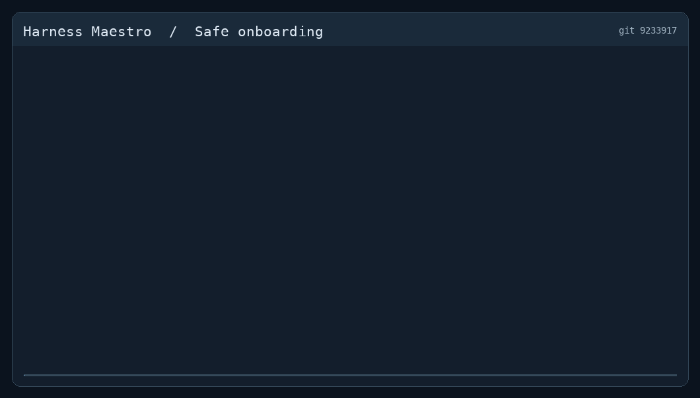
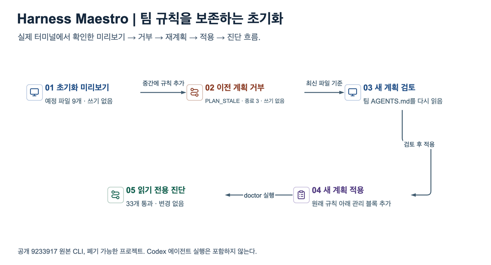
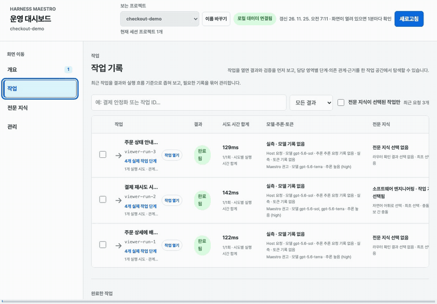
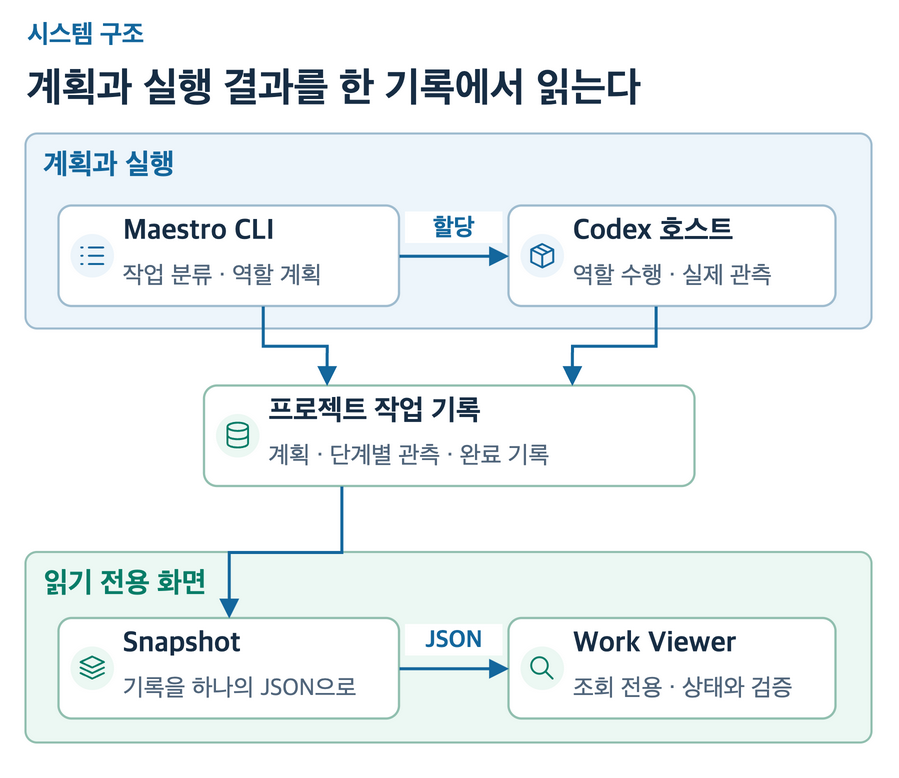
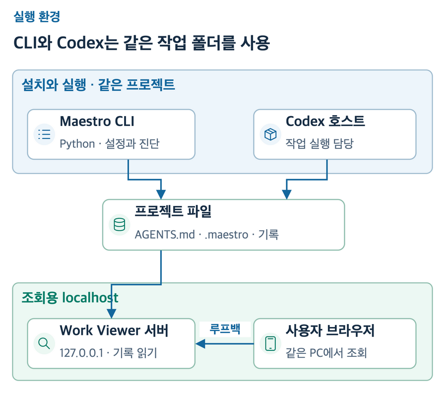
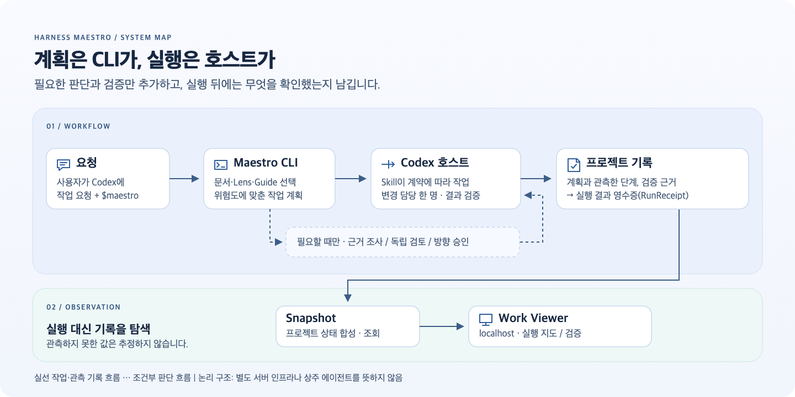
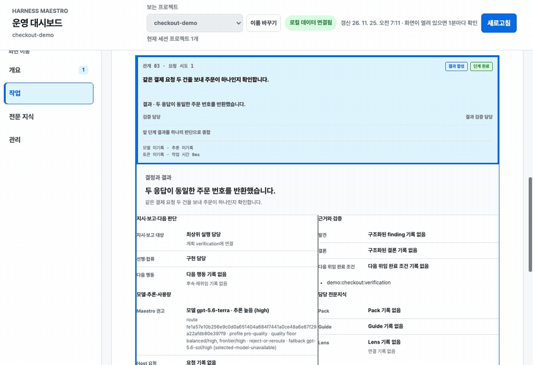
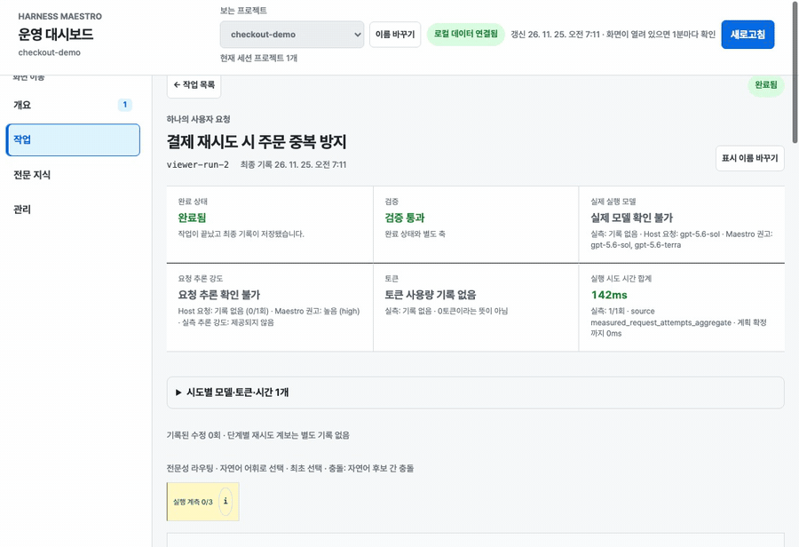

# Harness Maestro

**Codex 작업에 필요한 검토를 고르고, 계획한 일과 실제로 확인한 일을 구분하는 CLI 하네스.**

문서 오타 수정과 주문 API의 동시성 변경에 같은 절차를 적용할 필요는 없습니다. Harness Maestro는 위험도에 따라 검토 범위와 담당을 정하고, 실제 실행 결과와 확인한 근거는 계획과 별도로 남깁니다.

| 프로젝트 정보 | 내용 |
| --- | --- |
| 형태 | 저장소에 연결해 쓰는 Python CLI와 Codex 스킬, 로컬 Work Viewer |
| 기준 버전 | [공개 저장소에 병합된 커밋 `9233917`](https://github.com/SungKong00/harness-maestro/commit/9233917b9a48df29298d43aa76a338fe9e3db69b) |
| 실행 환경 | Python 3.11–3.13, Git. 에이전트 실행은 Codex 호스트가 필요합니다. |
| 담당 범위 | 위험도 기반 작업 분류, 판단과 구현 승인 분리, 프로젝트 규칙의 근거·승인 흐름 설계 및 구현. [공개 PR #1](https://github.com/SungKong00/harness-maestro/pull/1) |

## 기존 팀 규칙을 보존하면서 새 저장소에 연결하기

팀 저장소에 Maestro를 붙이려던 관리자가 변경 파일을 먼저 확인합니다. 그사이 팀원이 `AGENTS.md`를 추가하자 CLI가 예전 계획을 거부합니다. 관리자는 새 계획만 적용하고, 기존 규칙이 남았는지 확인한 뒤 `doctor`를 실행합니다.



재검토한 계획을 적용하면 기존 규칙을 유지하면서 9개 파일이 갱신되고, `doctor`의 33개 항목을 통과합니다.
[결과 한 장](docs/portfolio-readme/assets/onboarding-result.png) · [명령 출력](docs/portfolio-readme/docs/terminal-transcript.txt) · [확인 결과](docs/portfolio-readme/docs/evidence.json)

## 어떤 문제를 풀었나

작업에 검토자를 더 붙였다는 사실만으로 더 안전해지지는 않습니다. 같은 파일을 여러 주체가 고치면 변경 책임이 흐려지고, 계획한 검토가 실제로 실행됐는지도 별도로 확인해야 합니다. 그래서 **작업을 나누는 규칙**, **쓰기 권한**, **실행 근거**를 서로 다른 단계에서 다룹니다.

## 역할별 작업 흐름

| 시작하는 사람 | 하려는 일 | 실제 경로와 결과 |
| --- | --- | --- |
| 저장소 관리자 | 기존 팀 규칙을 유지한 채 처음 연결 | `init` 미리보기 → 검토한 계획 적용 → `doctor`. 적용 범위와 진단 결과를 확인합니다. |
| 개발자 | 방향이 정해진 변경을 맡기기 | 위험도에 따라 Fast / Standard / Deep으로 분류합니다. 단일 수정 담당, 검토자, 확인 기준을 Assignment 계획에 남깁니다. |
| 의사결정자 | 코드를 바꾸기 전에 대안 비교 | `decide`가 읽기 전용 판단을 수집하고, 승인이 있을 때만 `enact`가 실행 계획을 엽니다. |
| 검토자 | 작업이 끝난 뒤 근거 확인 | Work Viewer에서 작업을 검색하고 완료 상태·검증 결과·단계별 근거를 확인합니다. |
| 프로젝트 관리자 | 반복해서 빠지는 검증을 규칙으로 정리 | 기록에서 후보를 만들고 원래 근거를 확인합니다. 승인한 후보만 프로젝트 규칙에 반영합니다. |

### 저장소 관리자 · 승인한 설치 계획 적용



미리보기 다음에 파일이 바뀌면 다시 검토합니다. 그동안 CLI가 파일을 분리해서 조금씩 적용하지 않으므로, 처음 만든 계획이 기존 팀 규칙을 덮지 않습니다. [초기화 워크플로 편집용 draw.io](docs/portfolio-readme/assets/onboarding-flow.drawio) · [명령 출력](docs/portfolio-readme/docs/terminal-transcript.txt)

### 의사결정자 · 방향을 먼저 고르는 요청

“결제 재시도를 어떤 방식으로 처리할지 비교해 달라”면 `decide`로 진입합니다. 검토자가 대안과 근거를 정리하고, 선택이 확정되면 승인 범위를 묶어 `enact`로 넘깁니다. 반대로 변경 방법이 이미 정해져 있다면 일반 구현 경로에서 필요한 역할만 배정합니다. [판단과 실행의 흐름](https://github.com/SungKong00/harness-maestro/blob/9233917b9a48df29298d43aa76a338fe9e3db69b/docs/architecture/decision-workflow.md)

## Work Viewer에서 검토 결과 찾기

재시도 수정이 끝난 뒤, 검토자가 같은 결제로 주문이 두 번 생기지 않았는지 확인합니다. Work Viewer에서 ‘결제 재시도’를 검색해 작업을 열고 완료 상태와 검증 카드를 따로 봅니다.



*로컬 Work Viewer · 예시 작업 기록*

## 시스템 구조



CLI는 역할과 선행 조건을 저장소에 남깁니다. Snapshot은 계획, 단계별 결과, 최종 기록을 한 번에 읽어 Work Viewer에 전달합니다. 작업마다 결과 페이지를 따로 만드는 대신 하나의 화면에서 최근 작업과 확인 근거를 살펴볼 수 있게 했습니다.

[편집용 draw.io](docs/portfolio-readme/assets/system.drawio) · [SVG](docs/portfolio-readme/assets/system.svg) · [작업 계획 구조](https://github.com/SungKong00/harness-maestro/blob/9233917b9a48df29298d43aa76a338fe9e3db69b/docs/architecture/typed-assignment-plan.md)

## 주요 설계 결정

### 공통 커널은 작게 유지하고 프로젝트 지식은 필요한 만큼만 불러오기

저장소마다 하네스를 통째로 복사하면 같은 규칙이 다른 버전으로 흩어집니다. 반대로 설치·검토·도메인 지식을 하나의 스킬에 넣으면 간단한 요청도 모든 지침을 읽게 됩니다. CLI에는 **설치 계획, 검증, 작업 분류, 버전이 있는 규칙 목록**을 두고, 프로젝트별 판단은 Adapter와 선택형 Expertise Pack에 맡겼습니다. 단순 변경에는 필요한 문서와 검토 관점만 고르고, 프로젝트 고유 규칙은 CLI에 상수로 넣지 않아도 됩니다. [작은 커널을 선택한 이유](https://github.com/SungKong00/harness-maestro/blob/9233917b9a48df29298d43aa76a338fe9e3db69b/docs/decisions/0001-small-kernel.md)

### 초기화는 검토 당시 파일에만 적용

미리보기와 적용 사이에 팀원이 `AGENTS.md`를 수정할 수 있습니다. 미리보기 때 대상 파일별 해시를 기록하고, 적용 직전에 현재 파일과 먼저 대조합니다. 파일이 달라졌다면 `PLAN_STALE`로 중단하며 변경 계획 전체를 다시 검토합니다. 온보딩 시연에서 먼저 만든 계획은 아무 파일도 쓰지 않았고, 새 계획은 **기존 팀 규칙을 그대로 둔 채 Maestro 관리 영역만 추가**했습니다. [온보딩 실행 기록](docs/portfolio-readme/docs/terminal-transcript.txt)

### 검토 결과가 좋아도 구현 권한은 따로 열기

“두 설계를 비교해 달라”는 요청까지 기존 구현 경로로 보내면 검토가 끝나기 전에 수정 담당이 열립니다. 그래서 `decide`는 읽기 전용 역할만 사용하는 별도 경로로 두고, 대안·근거·제약을 `DecisionBundle`에 담습니다. `enact`는 근거 묶음과 현재 Git 리비전, 승인 범위, 해결된 차단 조건을 대조한 뒤 별도 실행 계획을 만듭니다. 실행 계획이 열리면 기존 단일 수정 담당·읽기 전용 검증 경로를 그대로 씁니다. 덕분에 검토가 필요한 일만 한 단계를 더 거치고, 방향이 이미 정해진 수정에는 같은 절차를 강제로 붙이지 않습니다. [판단과 실행을 분리한 ADR](https://github.com/SungKong00/harness-maestro/blob/9233917b9a48df29298d43aa76a338fe9e3db69b/docs/decisions/0007-separate-decision-and-execution.md)

### 작업마다 화면을 만들지 않고 하나의 스냅샷으로 보여주기

계획에 적힌 모델과 호스트에서 실제로 관측한 모델은 같은 값이 아닙니다. 요청에서 역할을 정한 계획, 단계별 관측, 완료 기록을 각각 저장하고, **같은 프로젝트 스냅샷이 세 기록을 한 화면에서 읽도록** 했습니다. Work Viewer는 목록·상세·검증 카드에서 같은 작업을 이어서 보여주고, 완료 상태와 검증 결과를 나눠 표시합니다. 작업마다 HTML을 생성하거나 실시간 이벤트 서버를 띄우는 대신, 화면이 열려 있는 동안 1분마다 로컬 스냅샷을 갱신합니다. [스냅샷과 Viewer 설계](https://github.com/SungKong00/harness-maestro/blob/9233917b9a48df29298d43aa76a338fe9e3db69b/docs/architecture/operations-viewer.md)

## 실행 환경



[실행 환경 편집용 draw.io](docs/portfolio-readme/assets/environment.drawio) · [SVG](docs/portfolio-readme/assets/environment.svg)

Python CLI와 프로젝트 기록은 저장소별로 관리하며 Work Viewer는 localhost에서 해당 기록을 읽습니다. Codex는 작업을 실행하고, CLI는 변경 확인과 최종 기록을 맡습니다.

[전체 기능과 실행 경계](docs/portfolio-readme/docs/flows.md) · [설치 가이드](https://github.com/SungKong00/harness-maestro/blob/9233917b9a48df29298d43aa76a338fe9e3db69b/docs/runbooks/getting-started.md) · [MIT License](https://github.com/SungKong00/harness-maestro/blob/9233917b9a48df29298d43aa76a338fe9e3db69b/LICENSE)

<details>
<summary>기존 설치·개발 안내</summary>

# Harness Maestro

**작업마다 필요한 검토만 골라 쓰고, 무엇을 확인했는지 남기는 Codex 하네스.**

문서 오타 수정과 주문 API의 동시성 변경에 같은 절차를 적용할 필요는 없습니다. Maestro는 **CLI가 계획과 검증 조건을 만들고, Codex가 그 조건 안에서 작업**하도록 나눴습니다. 단순한 변경은 짧게 끝내고, 근거가 부족하거나 위험한 변경에만 검토를 더합니다.

## 기능 한눈에 보기

| 기능 | 이런 요청에 | 남는 결과 |
| --- | --- | --- |
| [초기화와 상태 점검](#초기화와-상태-점검) | “이 저장소에 연결하기 전에 바뀔 파일부터 보여줘.” | 초기화 계획, 준비 상태, `doctor` 점검 결과 |
| [구현 라우팅](#구현-라우팅) | “주문 재시도에서 중복 생성되지 않도록 고쳐줘.” | 작업 계획, 변경 담당과 검토 역할, 검증 근거 |
| [설계 판단과 구현 승인](#설계-판단과-구현-승인) | “이 화면의 대안을 비교만 해줘. 아직 코드는 바꾸지 마.” | 대안·근거·기술 제약을 묶은 결정 결과 |
| [검토 관점과 조건부 리서치](#검토-관점과-조건부-리서치) | “화면을 개선하되 최신 브라우저 제약이 중요하면 확인해줘.” | 적용할 Lens·Guide, 필요할 때만 검증된 ResearchBundle |
| [Snapshot과 Work Viewer](#snapshot과-work-viewer) | “어떤 검토가 실제 변경과 검증으로 이어졌는지 보고 싶어.” | 프로젝트별 JSON snapshot과 로컬 작업 지도 |
| [규칙 제안과 활성화](#규칙-제안과-활성화) | “같은 변경에서 반복해서 빠진 검증을 규칙 후보로 정리해줘.” | 검토용 Convention 초안, 별도 활성화·갱신 계획 |



[SVG 원본](assets/maestro-system.svg) · [편집용 Mermaid](assets/maestro-system.mmd)

## 초기화와 상태 점검

**입력:** `$maestro 이 저장소에 연결하기 전에 생성하거나 수정할 파일부터 보여줘.`

**결과:** `init`은 먼저 파일·경로별 변경 계획을 냅니다. 검토한 계획을 적용한 뒤 프로젝트 설명과 아키텍처 초안을 실제 내용으로 채웁니다. `status`는 준비 상태와 다음 조치를, `doctor`는 설정·관리 기준선·문서 링크 등을 표시합니다. `doctor --host codex`로 Codex 연결도 별도로 확인할 수 있습니다.

```bash
maestro init --repo /path/to/project --json
maestro status --repo /path/to/project
maestro doctor --repo /path/to/project --host codex
```

이 예시에서 첫 명령은 **미리보기**입니다. 적용 방법과 Python 3.11–3.13·`uv`·Codex 설치 조건은 [설치 및 초기화 가이드](https://github.com/SungKong00/harness-maestro/blob/9233917b9a48df29298d43aa76a338fe9e3db69b/docs/runbooks/getting-started.md)를 참고하세요.

<details>
<summary>CLI 설치와 Codex Skill 연결 명령</summary>

**개발용 체크아웃:** 아래 경로는 실제 설치할 위치로 바꿉니다. 편집 가능한 설치는 소스 변경을 바로 반영합니다.

```bash
git clone https://github.com/SungKong00/harness-maestro.git /path/to/harness-maestro
uv tool install --editable /path/to/harness-maestro
command -v maestro
maestro --version
```

**발행된 버전 고정:** 원격에 실제로 발행된 태그가 있을 때만 `<published-tag>`를 그 태그로 바꿔 실행합니다.

```bash
git -C /path/to/harness-maestro fetch --tags
git -C /path/to/harness-maestro checkout --detach <published-tag>
python3 /path/to/harness-maestro/scripts/release_manifest.py \
  --check --tag-ref <published-tag>
uv tool install /path/to/harness-maestro
```

**Codex에 처음 연결:** 같은 설치 원본으로 연결 계획을 만든 뒤, 변경 내용을 검토하고 적용합니다.

```bash
host_plan="$(mktemp -t maestro-host-sync.XXXXXX)"
maestro host sync --host codex --source-root /path/to/harness-maestro --json > "$host_plan"
# 계획을 검토한 뒤:
maestro host sync --apply-plan "$host_plan" --json
maestro doctor --repo /path/to/harness-maestro --host codex --strict --json
```

연결 뒤 현재 Codex 세션에 새 Skill이 보이지 않을 때만 Codex를 다시 시작합니다(restart the agent client). 프로젝트 초기화와 plan 적용은 위 가이드를 따릅니다.

</details>

## 구현 라우팅

**입력:** `$maestro 같은 요청이 재시도돼도 주문이 한 번만 생성되게 바꿔줘.`

**결과:** 문서·목표·위험도에 따라 Fast / Standard / Deep 경로에서 작업 계획을 만듭니다. 예시 주문 작업은 동시성·응답 계약·테스트 조건을 따로 검토한 뒤, **변경 담당 한 명이** 수정하고 검증 결과를 남기는 흐름입니다. 반대로 가이드 오탈자는 짧은 경로로 처리할 수 있습니다. 검토 역할이 늘어도 수정 담당을 그만큼 늘리지는 않습니다.

계획에는 담당 역할·선행 관계·계획한 확인 사항이 들어갑니다. 완료 여부는 실행 기록과 검증 근거로 따로 확인합니다. [작업 계획 구조](https://github.com/SungKong00/harness-maestro/blob/9233917b9a48df29298d43aa76a338fe9e3db69b/docs/architecture/typed-assignment-plan.md)

## 설계 판단과 구현 승인

**입력:** `$maestro 관리자 폼을 한 화면과 단계형으로 나눠 비교해줘. 아직 코드는 바꾸지 마.`

**결과:** `decide`는 읽기 전용으로 대안을 비교하고, 독립 검토와 기술 타당성 확인을 거쳐 결정 결과(`DecisionBundle`)를 만듭니다. 그렇게 방향을 정했다고 바로 변경하지 않습니다. 구현을 요청하면 `enact`가 결정 묶음·현재 소스·변경 범위·승인을 다시 확인해 실행에 넘깁니다. 고위험 작업은 별도의 명시적 사용자 승인이 필요합니다. [판단·실행 계약](https://github.com/SungKong00/harness-maestro/blob/9233917b9a48df29298d43aa76a338fe9e3db69b/docs/architecture/decision-workflow.md)

## 검토 관점과 조건부 리서치

**입력:** `$maestro 상품 검색 폼의 키보드 사용성과 오류 복구를 검토해줘. 최신 브라우저 동작이 결론을 바꿀 때만 조사해줘.`

| 구분 | 예시 | 역할 |
| --- | --- | --- |
| **Lens** | 사용자 흐름, 동시성, 검증 근거 | 이번 작업에서 놓치기 쉬운 실패를 보는 관점 |
| **Expertise Pack / Guide** | 디자인의 접근성 가이드, QA의 회귀 기준 | 여러 작업에서 재사용하는 판단 기준 |
| **조건부 리서치** | 현재 브라우저 제약 확인 | 기존 근거가 충분하면 생략. 조사할 때는 출처·주장·검증 결과를 ResearchBundle로 묶은 뒤 계획에 반영 |

Pack을 고른 것은 별도 에이전트가 떴거나 그 기준을 실제 적용했다는 증거가 아닙니다. 어떤 기준이 선택·전달됐는지와 실제 본문 로드·결과 반영을 구분합니다. [전문성·리서치 구조](https://github.com/SungKong00/harness-maestro/blob/9233917b9a48df29298d43aa76a338fe9e3db69b/docs/architecture/expertise-packs.md)

## Snapshot과 Work Viewer

**입력:** 실행 결과가 기록된 프로젝트에서 `maestro snapshot --repo /path/to/project --json` 또는 `maestro dashboard --repo /path/to/project`.

**결과:** CLI는 프로젝트 설정과 계획·관측·최종 기록을 읽어 JSON snapshot을 합성합니다. Work Viewer에서는 목록을 검색하고, 작업을 열어 완료 여부와 검증 결과를 따로 보고, 카드에서 각 단계의 관계와 근거를 확인합니다. **권고 모델은 실제 모델이 아니고, 기록 없는 토큰은 0이 아닙니다.**



*실행 지도: 독립 검토 결과가 변경 단계로 모이고 검증으로 이어집니다. 같은 줄은 선행 관계상 같은 단계입니다.*



*작업 요약: 예제 작업의 완료 상태와 검증 결과를 따로 확인합니다.*

**범위:** Work Viewer는 프로젝트 기록을 조회하는 localhost 화면입니다. Codex 전체 활동을 실시간 중계·수집하거나, 작업을 재생·자동 재개하는 런타임이 아닙니다. 검증 명령 등록 같은 별도 관리 동작은 확인을 요구합니다. [뷰어 계약](https://github.com/SungKong00/harness-maestro/blob/9233917b9a48df29298d43aa76a338fe9e3db69b/docs/architecture/operations-viewer.md)

## 규칙 제안과 활성화

**입력:** “최근 주문 변경에서 재시도 회귀 검증이 반복해서 빠졌는지 보고, 필요하면 규칙 초안만 만들어줘.”

**결과:** `govern report`는 최근 기록을 읽고 반복 신호를 보여줍니다. 그 신호는 확정 규칙이 아닙니다. 규칙이 적합하면 `maestro convention draft`로 Convention 초안을 검토용으로 만들고, 프로젝트에 적용하려면 근거를 붙인 **별도의 활성화 계획**을 검토·적용합니다. 기존 규칙의 갱신도 같은 방식으로 구분합니다. [구성요소 변경과 활성화 기준](https://github.com/SungKong00/harness-maestro/blob/9233917b9a48df29298d43aa76a338fe9e3db69b/docs/governance/component-lifecycle.md)

CLI와 Skill은 여러 저장소에서 쓸 수 있지만, 설정·문서·규칙·작업 기록은 프로젝트마다 따로 둡니다. CLI 버전을 올리는 것과 프로젝트의 관리 기준선을 `upgrade`하는 것도 별개입니다.

**만든 부분:** 프로젝트 소유자로서 작업 위험에 맞춘 라우팅, 판단과 구현의 분리, 프로젝트 규칙의 근거·승인 흐름을 설계하고 구현했습니다. 변경 범위는 [공개 PR #1](https://github.com/SungKong00/harness-maestro/pull/1)에서 확인할 수 있습니다.

[문서 지도](https://github.com/SungKong00/harness-maestro/blob/9233917b9a48df29298d43aa76a338fe9e3db69b/docs/README.md) · [MIT License](https://github.com/SungKong00/harness-maestro/blob/9233917b9a48df29298d43aa76a338fe9e3db69b/LICENSE)

</details>
