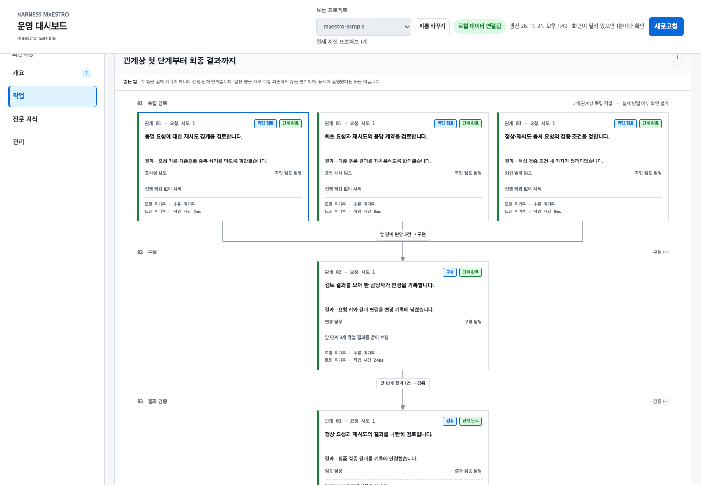
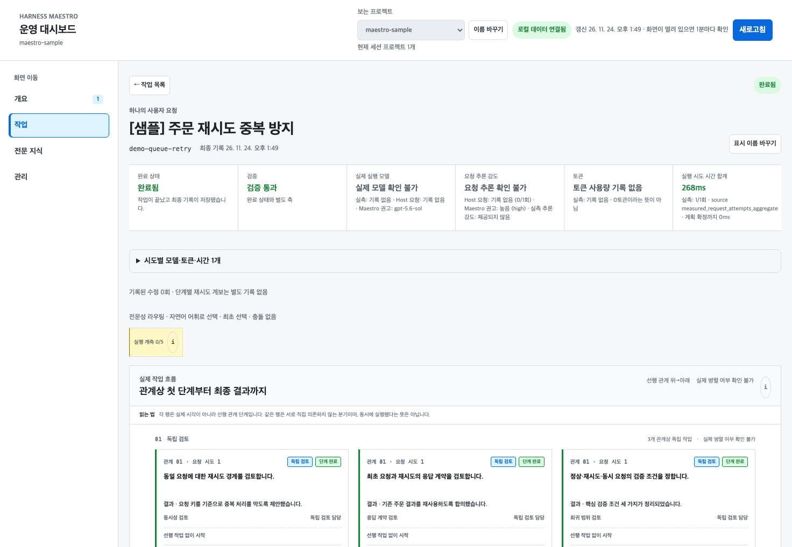

# Harness Maestro

**작업마다 필요한 검토만 골라 쓰고, 무엇을 확인했는지 남기는 Codex 하네스.**

문서 오타 수정과 주문 API의 동시성 변경에 같은 절차를 적용할 필요는 없습니다. Maestro는 **CLI가 계획과 검증 조건을 만들고, Codex가 그 조건 안에서 작업**하도록 나눴습니다. 단순한 변경은 짧게 끝내고, 근거가 부족하거나 위험한 변경에만 검토를 더합니다.

## 기능 한눈에 보기

| 기능 | 이런 요청에 | 남는 결과 |
| --- | --- | --- |
| [초기화와 상태 점검](#초기화와-상태-점검) | “이 저장소에 연결하기 전에 바뀔 파일부터 보여줘.” | 초기화 계획, 준비 상태, `doctor` 점검 결과 |
| [구현 라우팅](#구현-라우팅) | “주문 재시도에서 중복 생성되지 않도록 고쳐줘.” | 작업 계획, 변경 담당과 검토 역할, 검증 근거 |
| [설계 판단과 구현 승인](#설계-판단과-구현-승인) | “이 화면의 대안을 비교만 해줘. 아직 코드는 바꾸지 마.” | 대안·근거·기술 제약을 묶은 결정 결과 |
| [검토 관점과 조건부 리서치](#검토-관점과-조건부-리서치) | “화면을 개선하되 최신 브라우저 제약이 중요하면 확인해줘.” | 적용할 Lens·Guide, 필요할 때만 검증된 ResearchBundle |
| [Snapshot과 Work Viewer](#snapshot과-work-viewer) | “어떤 검토가 실제 변경과 검증으로 이어졌는지 보고 싶어.” | 프로젝트별 JSON snapshot과 로컬 작업 지도 |
| [규칙 제안과 활성화](#규칙-제안과-활성화) | “같은 변경에서 반복해서 빠진 검증을 규칙 후보로 정리해줘.” | 검토용 Convention 초안, 별도 활성화·갱신 계획 |


[SVG 원본](assets/maestro-system.svg) · [편집용 Mermaid](assets/maestro-system.mmd)

## 초기화와 상태 점검

**입력:** `$maestro 이 저장소에 연결하기 전에 생성하거나 수정할 파일부터 보여줘.`

**결과:** `init`은 먼저 파일·경로별 변경 계획을 냅니다. 검토한 계획을 적용한 뒤 프로젝트 설명과 아키텍처 초안을 실제 내용으로 채웁니다. `status`는 준비 상태와 다음 조치를, `doctor`는 설정·관리 기준선·문서 링크 등을 표시합니다. `doctor --host codex`로 Codex 연결도 별도로 확인할 수 있습니다.

```bash
maestro init --repo /path/to/project --json
maestro status --repo /path/to/project
maestro doctor --repo /path/to/project --host codex
```

이 예시에서 첫 명령은 **미리보기**입니다. 적용 방법과 Python 3.11–3.13·`uv`·Codex 설치 조건은 [설치 및 초기화 가이드](https://github.com/SungKong00/harness-maestro/blob/9233917b9a48df29298d43aa76a338fe9e3db69b/docs/runbooks/getting-started.md)를 참고하세요.

## 구현 라우팅

**입력:** `$maestro 같은 요청이 재시도돼도 주문이 한 번만 생성되게 바꿔줘.`

**결과:** 문서·목표·위험도에 따라 Fast / Standard / Deep 경로에서 작업 계획을 만듭니다. 예시 주문 작업은 동시성·응답 계약·테스트 조건을 따로 검토한 뒤, **변경 담당 한 명이** 수정하고 검증 결과를 남기는 흐름입니다. 반대로 가이드 오탈자는 짧은 경로로 처리할 수 있습니다. 검토 역할이 늘어도 수정 담당을 그만큼 늘리지는 않습니다.

계획에는 담당 역할·선행 관계·계획한 확인 사항이 들어갑니다. 완료 여부는 실행 기록과 검증 근거로 따로 확인합니다. [작업 계획 구조](https://github.com/SungKong00/harness-maestro/blob/9233917b9a48df29298d43aa76a338fe9e3db69b/docs/architecture/typed-assignment-plan.md)

## 설계 판단과 구현 승인

**입력:** `$maestro 관리자 폼을 한 화면과 단계형으로 나눠 비교해줘. 아직 코드는 바꾸지 마.`

**결과:** `decide`는 읽기 전용으로 대안을 비교하고, 독립 검토와 기술 타당성 확인을 거쳐 결정 결과(`DecisionBundle`)를 만듭니다. 그렇게 방향을 정했다고 바로 변경하지 않습니다. 구현을 요청하면 `enact`가 결정 묶음·현재 소스·변경 범위·승인을 다시 확인해 실행에 넘깁니다. 고위험 작업은 별도의 명시적 사용자 승인이 필요합니다. [판단·실행 계약](https://github.com/SungKong00/harness-maestro/blob/9233917b9a48df29298d43aa76a338fe9e3db69b/docs/architecture/decision-workflow.md)

## 검토 관점과 조건부 리서치

**입력:** `$maestro 상품 검색 폼의 키보드 사용성과 오류 복구를 검토해줘. 최신 브라우저 동작이 결론을 바꿀 때만 조사해줘.`

| 구분 | 예시 | 역할 |
| --- | --- | --- |
| **Lens** | 사용자 흐름, 동시성, 검증 근거 | 이번 작업에서 놓치기 쉬운 실패를 보는 관점 |
| **Expertise Pack / Guide** | 디자인의 접근성 가이드, QA의 회귀 기준 | 여러 작업에서 재사용하는 판단 기준 |
| **조건부 리서치** | 현재 브라우저 제약 확인 | 기존 근거가 충분하면 생략. 조사할 때는 출처·주장·검증 결과를 ResearchBundle로 묶은 뒤 계획에 반영 |

Pack을 고른 것은 별도 에이전트가 떴거나 그 기준을 실제 적용했다는 증거가 아닙니다. 어떤 기준이 선택·전달됐는지와 실제 본문 로드·결과 반영을 구분합니다. [전문성·리서치 구조](https://github.com/SungKong00/harness-maestro/blob/9233917b9a48df29298d43aa76a338fe9e3db69b/docs/architecture/expertise-packs.md)

## Snapshot과 Work Viewer

**입력:** 실행 결과가 기록된 프로젝트에서 `maestro snapshot --repo /path/to/project --json` 또는 `maestro dashboard --repo /path/to/project`.

**결과:** CLI는 프로젝트 설정과 계획·관측·최종 기록을 읽어 JSON snapshot을 합성합니다. Work Viewer에서는 목록을 검색하고, 작업을 열어 완료 여부와 검증 결과를 따로 보고, 카드에서 각 단계의 관계와 근거를 확인합니다. **권고 모델은 실제 모델이 아니고, 기록 없는 토큰은 0이 아닙니다.**



*실행 지도: 독립 검토 결과가 변경 단계로 모이고 검증으로 이어집니다. 같은 줄은 선행 관계상 같은 단계이며 동시 실행을 증명하지 않습니다.*



*작업 요약: 완료와 검증은 별개입니다. 두 스크린샷은 공개 main의 실제 UI이며 [샘플]의 결과·시간은 시연 데이터입니다. 실제 Codex 작업, 테스트 실행 또는 성능 측정이 아닙니다.*

**범위:** Work Viewer는 프로젝트 기록을 조회하는 localhost 화면입니다. Codex 전체 활동을 실시간 중계·수집하거나, 작업을 재생·자동 재개하는 런타임이 아닙니다. 검증 명령 등록 같은 별도 관리 동작은 확인을 요구합니다. [뷰어 계약](https://github.com/SungKong00/harness-maestro/blob/9233917b9a48df29298d43aa76a338fe9e3db69b/docs/architecture/operations-viewer.md)

## 규칙 제안과 활성화

**입력:** “최근 주문 변경에서 재시도 회귀 검증이 반복해서 빠졌는지 보고, 필요하면 규칙 초안만 만들어줘.”

**결과:** `govern report`는 최근 기록을 읽고 반복 신호를 보여줍니다. 그 신호는 확정 규칙이 아닙니다. 규칙이 적합하면 Convention 초안을 검토용으로 만들고, 프로젝트에 적용하려면 근거를 붙인 **별도의 활성화 계획**을 검토·적용합니다. 기존 규칙의 갱신도 같은 방식으로 구분합니다. [구성요소 변경과 활성화 기준](https://github.com/SungKong00/harness-maestro/blob/9233917b9a48df29298d43aa76a338fe9e3db69b/docs/governance/component-lifecycle.md)

CLI와 Skill은 여러 저장소에서 쓸 수 있지만, 설정·문서·규칙·작업 기록은 프로젝트마다 따로 둡니다. CLI 버전을 올리는 것과 프로젝트의 관리 기준선을 `upgrade`하는 것도 별개입니다.

**만든 부분:** 프로젝트 소유자로서 작업 위험에 맞춘 라우팅, 판단과 구현의 분리, 프로젝트 규칙의 근거·승인 흐름을 설계하고 구현했습니다. 변경 범위는 [공개 PR #1](https://github.com/SungKong00/harness-maestro/pull/1)에서 확인할 수 있습니다.

[문서 지도](https://github.com/SungKong00/harness-maestro/blob/9233917b9a48df29298d43aa76a338fe9e3db69b/docs/README.md) · [MIT License](https://github.com/SungKong00/harness-maestro/blob/9233917b9a48df29298d43aa76a338fe9e3db69b/LICENSE)
