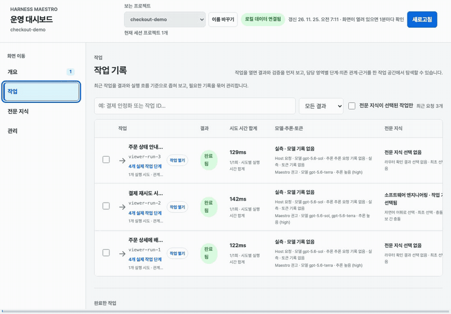

# Harness Maestro · 기능과 실행 경계

[README로](../../../README.md)

## CLI로 초기화할 때

`maestro init --repo <project> --json`으로 파일별 변경 계획을 먼저 확인합니다. 계획을 검토한 후 `--apply-plan`에 그대로 전달합니다. 대상 파일이 그 사이 바뀌면 예전 계획으로 진행하지 않습니다. `status`는 준비 상태를, `doctor`는 관리 기준선·문서 경로·구성 계약을 읽기 전용으로 점검합니다. `doctor --host codex`는 호스트 연결을 별도로 점검할 때 사용합니다.

## 검토와 구현을 분리할 때

“주문이 재시도돼도 한 번만 생성되게”라는 요청이라면 동시성, 응답 계약과 재시도 검증을 확인 기준에 넣을 수 있습니다. “두 설계를 비교하되 아직 수정하지 말라”는 상황이라면 읽기 전용 결정 단계에 머뭅니다.

- **Lens:** 이번 변경의 실패 가능성을 보는 관점입니다.
- **Guide / Expertise Pack:** 여러 작업에서 쓰는 프로젝트별 기준입니다. 선택과 전달이 그 기준을 실제로 읽고 적용했다는 증거는 아닙니다.
- **ResearchBundle:** 현재 외부 근거가 결론을 바꿀 때만, 출처·주장·검증 상태를 함께 묶습니다.
- **Convention:** 반복해서 나타난 결함을 개선할 후보입니다. 후보 생성과 실제 활성화는 별도입니다.

[판단과 구현 승인 계약](https://github.com/SungKong00/harness-maestro/blob/9233917b9a48df29298d43aa76a338fe9e3db69b/docs/architecture/decision-workflow.md) · [전문성 구조](https://github.com/SungKong00/harness-maestro/blob/9233917b9a48df29298d43aa76a338fe9e3db69b/docs/architecture/expertise-packs.md)

## Work Viewer에서 확인할 수 있는 기록

결제 재시도 작업을 검색해 상태 요약과 단계별 근거를 확인합니다. 검증 카드를 열면 같은 요청을 두 번 보낸 사례의 결과가 표시됩니다. 목록과 상세는 동일한 프로젝트 스냅샷을 읽습니다.

[작업 지도 캡처](../assets/work-viewer-graph.png) · [작업 요약 캡처](../assets/work-viewer.png) · [Viewer 계약](https://github.com/SungKong00/harness-maestro/blob/9233917b9a48df29298d43aa76a338fe9e3db69b/docs/architecture/operations-viewer.md)
